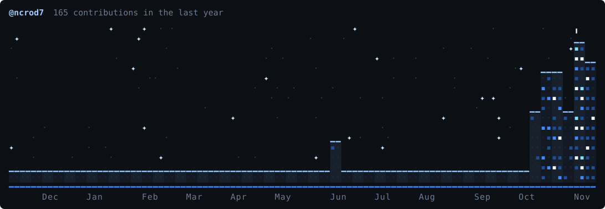
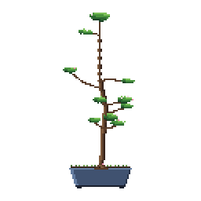

  

  
  
  

## `$ ls ./stack`

<table align="center">
  <tr>
    <td><b>Front-end</b></td>
    <td></td>
  </tr>
  <tr>
    <td><b>Back-end</b></td>
    <td></td>
  </tr>
  <tr>
    <td><b>Datos</b></td>
    <td>   </td>
  </tr>
  <tr>
    <td><b>cloud · sistemas</b></td>
    <td></td>
  </tr>
  <tr>
    <td><b>herramientas</b></td>
    <td> </td>
  </tr>
</table>

## `$ cat actividad.log`

<table align="center">
  <tr>
    <td>
      
    </td>
    <td>
      
    </td>
  </tr>
</table>

  

  

  

  

