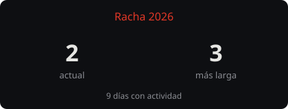

<pre>
 _ __   ___ _ __ ___   __| |
| '_ \ / __| '__/ _ \ / _` |
| | | | (__| | | (_) | (_| |
|_| |_|\___|_|  \___/ \__,_|
</pre>

  

  
  

---

<b>STACK · A DIARIO</b>

  

  

  

  
  
  
  
  
  
  
  
  

<b>CAPACIDADES</b>

  
  
  
  
  
  

---

<table align="center">
  <tr>
    <td>
      
      
    </td>
    <td>
      
      
    </td>
  </tr>
</table>

  

  
  

  

  <code>ncrod.dev</code> · Astro · React · Tailwind · <a href="https://github.com/ncrod7/portfoliodef">portfolio</a>

